<b>📄 Plain-text version</b>

### Krunal Chauhan · Full Stack Engineer

Full Stack Engineer at **Vnnovate Solutions**, based in Ahmedabad, India. I work with Laravel, React and Next.js, building scalable applications and AI-powered systems, and I'm exploring AI agents, automation and cloud technologies.

**What I do:** Backend (Laravel APIs and scalable services) · Frontend (React and Next.js) · AI agents (LLM workflows and automation) · Cloud (deployments and cloud technologies)

**Stack:** Laravel, PHP, REST APIs · React, Next.js, JavaScript, Tailwind CSS, HTML / CSS · AI agents, automation, cloud, GSAP

**Work:** [krunal-portfolio](https://github.com/krunalchauhan721-eng/krunal-portfolio), built with React.js and TypeScript.

